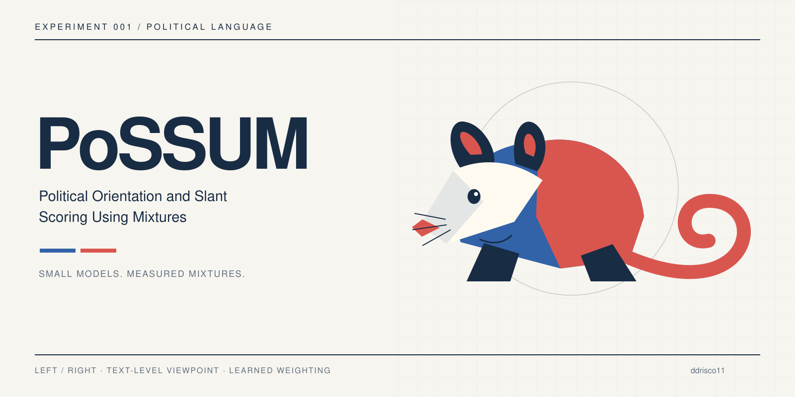

# PoSSUM
**Political Orientation and Slant Scoring Using Mixtures**

A short experiment: does a small, embedding-conditioned mixture beat a strong single model at classifying the political viewpoint expressed in a short U.S. political passage?

**Labels:** `0 = Left`, `1 = Right`. **Status:** initial implementation; no scientific conclusions yet. Model weights and source datasets are downloaded separately and never committed.

## Experiment in three steps
1. Freeze encoders; run a small grouped pilot with BGE-small, BERT, GLiNER, and a lexical baseline.
2. Calibrate component scores; compare best single, equal average, fixed mixture, and a 384 → 32 → K neural gate. Run leave-one-component-out ablations.
3. Only if validation evidence supports it, expand the data, audit Mistral/Qwen logits, and fine-tune selected encoders. Open the reserved test set once the recipe is fixed.

This is a dense mixture of predictions, not a sparsely routed language model: every enabled expert runs. A gate does not automatically reduce inference cost.

See [experiment protocol](docs/experiment.md), [model registry](docs/models.md), and [dataset manifest](docs/datasets.md).

## Local setup (Apple Silicon)
```bash
python3.12 -m venv .venv
source .venv/bin/activate
pip install -e '.[dev]'
pytest
possum --help
```

Use one component at a time and cache scores. The default pilot avoids 7–27B weight downloads. OpenJev is disabled on a 16 GB Mac; its smallest official MLX checkpoint alone is approximately 15 GB. Optional MLX causal audits require `pip install -e '.[mlx]'` and explicit model selection. No cloud compute is started automatically.

## Reproducibility
All commits use the repository owner's configured Git identity. Record checkpoint revisions, dataset hashes, split membership, dependency versions, seeds, score prompts, and device in every run. Raw corpora, model caches and sample-level outputs stay ignored. Public reports contain aggregate metrics only.

This experiment measures expressed viewpoint, not an individual's beliefs. Party/source labels are noisy supervision; they are not human verification of a passage's viewpoint. Neutral and ambiguous input is outside the binary training target. Production abstention and politicalness detection remain separate evaluation tasks.
